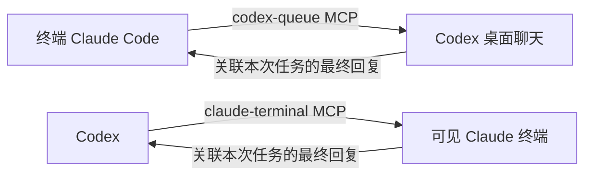

# Codex ↔ Claude Bridge（Windows）

让 **终端 Claude Code** 与 **Codex 桌面聊天**互相派发任务，并读回对应回复的本地 stdio MCP。支持指定已有会话 ID，也支持在调用方当前项目新建。无需 Claude 桌面版。

例如：让 Claude 把代码审查交给某个 Codex 桌面聊天；也可以让 Codex 打开可见的 Claude 终端处理任务。你能在接收端继续查看和参与对话。

**当前版本：1.1.0 · Windows · MIT**

[功能与原理讲解](docs/guide.md) · [工具与参数参考](docs/reference.md) · [常见问题](docs/troubleshooting.md) · [验证记录](docs/verification.md) · [第三方来源](THIRD_PARTY_NOTICES.md)



## 可以做什么

- **双向派发任务**：Claude → Codex 桌面，Codex → Claude 终端。
- **指定 ID 续聊**：沿用目标会话已有的上下文、项目、模型和权限。
- **省略 ID 新建**：创建 Codex 桌面聊天，或打开可见的 Claude 原生终端。
- **跨本地项目**：不用为每个项目、会话 ID 手改配置。
- **发送后查询**：通过 requestId 等待和读取结果，超时后继续查询。
- **快捷 Skill**：Claude 中用 `/to-codex`，Codex 中选择 `to-claude` 或 `claude-sessions`，不用记完整 MCP 名称。
- **独立安装维护**：检测依赖、备份配置、一键安装、测试和卸载，同时管理配套 Skill。

当前范围是同一 Windows 用户的本地会话。它不提供其他 AI 执行器、远程机器调度或自动循环对话，也不替代接收端的权限审批。

## 快速安装

从 GitHub 的 **Code → Download ZIP** 下载源码，或使用 Git 克隆：

```bat
git clone https://github.com/kunkunxhk/codex-claude-bridge.git
cd codex-claude-bridge
```

1. 将下载的 ZIP 解压到一个长期保留的目录，或进入克隆目录。路径可以含中文和空格。不要在 ZIP 内直接运行。
2. 确保已安装并登录 Codex 桌面端和终端 Claude Code，且能分别正常回答问题。
3. 安装 Node.js 22+（包含 npm）和 Python 3，将 Node 加入 PATH。
4. 双击 **install.cmd**，安装锁定的 npm 依赖，自动检测原生执行文件，先做 MCP 连接测试，再备份并写入两端配置和快捷 Skill。
5. 重新启动 Claude Code 和 Codex 桌面端，双击 **test.cmd** 检查连接。

安装本项目不需要管理员权限。安装 npm 依赖需要网络。不会自动安装、登录或更改第三方 CLI 的模型、权限、账号和额度。

官方下载/文档：[Node.js](https://nodejs.org/en/download)、[Python](https://www.python.org/downloads/windows/)、[Claude Code 安装](https://code.claude.com/docs/en/setup)、[Codex/Windows 文档](https://developers.openai.com/codex/app/windows/)。CLI 自身还需要的运行环境请按其官方文档准备。

## 一键入口

| 文件 | 行为 |
| --- | --- |
| install.cmd | npm ci、检测依赖、测试入口、备份并注册双向 MCP 及三个快捷 Skill |
| configure.cmd | 重新检测、配置、更新 Skill；旧版升级到 1.1.0 时也使用此入口 |
| doctor.cmd | 检查可执行文件、版本和 queue 能力；显示 Skill 安装路径与完整性 |
| test.cmd | 检查 Skill 文件，再启动两端 stdio MCP 并调用只读状态/在线会话列表 |
| uninstall.cmd | 恢复安装前的两个 MCP 项和受管理的 Skill 文件，保留其他设置和聊天记录 |

双击执行结束会暂停，便于阅读错误。脚本化执行可使用 `node bin/bridge.mjs <命令> --json`。`test.cmd --json` 同样不会暂停。

默认测试不发送模型任务，也不能证明账号/额度或桌面端正在运行。需要完整验证时，先取得真实 ID，再运行：

```bat
test.cmd --live --claude-session "替换为在线Claude会话UUID" --codex-thread "替换为Codex桌面聊天UUID" --json
```

可只填其中一个。它会向指定会话发送固定的“只回复测试标识、不调用工具”的消息，等待并核对回复，消耗接收方正常额度。不会自动创建新窗口/聊天，超时也不重发。输出 `requestId` 可供后续 read/wait。

## 在 AI 里使用

安装后可直接使用以下快捷入口：

| 宿主 | 快捷入口 | 作用 |
| --- | --- | --- |
| Claude Code | `/to-codex 任务内容` | 在当前项目新建 Codex 桌面聊天，投递并等待回复 |
| Claude Code | `/to-codex --thread UUID 任务内容` | 交给指定 Codex 聊天 |
| Codex | `$to-claude 任务内容` | 在当前项目打开新 Claude 终端，投递并等待回复 |
| Codex | `$to-claude --session UUID 任务内容` | 交给指定在线 Claude 会话 |
| Codex | `$claude-sessions` | 仅列出在线 Claude 会话及完整 ID |

在 Codex 桌面端也可以从技能选择器中搜索 `to-claude` 或 `claude-sessions`；CLI/IDE 可用 `/skills` 或 `$` 选择。不同客户端的菜单入口可能不同，Skill 名称相同。Skill 负责组装调用流程，执行仍由 MCP 和接收端完成。

Claude Skill 安装到 Claude 用户目录的 `skills/to-codex`；Codex Skill 安装到 Codex 用户目录的 `skills/to-claude` 和 `skills/claude-sessions`。遵循自定义 --claude-home / --codex-home。安装后未出现时重启宿主，检查 doctor 的 skills 部分。

也可以用自然语言调用：

对 Claude 说：

> 用 codex-queue 给 Codex 聊天 ID `<UUID>` 发送任务，然后等待并读取回复。

> 用 codex-queue 在我当前项目创建一个 Codex 桌面聊天，完成这项任务。创建时传当前项目的绝对 cwd。

对 Codex 说：

> 用 claude-terminal 列出在线 Claude 会话，显示 ID、项目和终端名称。

> 用 claude-terminal 给 Claude 会话 ID `<UUID>` 发送任务并读取回复。

> 用 claude-terminal 在当前项目打开一个新的可见 Claude 终端，发送任务并读取回复。创建时传当前项目的绝对 cwd。

指定 ID 可跨任意本地项目；现有会话保留原来的项目、上下文、模型和权限。省略 ID 才新建。对于已关闭的 Claude 会话，先手动 `claude --resume <UUID>` 打开，再从在线列表确认。不能给任意其他用户或远程机器上的 ID 发送消息。

工具列表：

| Claude 中的 codex-queue | Codex 中的 claude-terminal |
| --- | --- |
| codex_queue_send | claude_terminal_send |
| codex_queue_wait | claude_terminal_wait |
| codex_queue_read | claude_terminal_read |
| codex_queue_status | claude_terminal_list |

单条任务最多 16,000 UTF-8 字节；Codex 完整回复默认不截断，可选 `maxReplyChars` 控制返回量。长任务用文件路径和简要目标，避免往返复制整份代码。每次发送保留 `requestId`；等待超时继续 wait/read，不能换 ID 重发。

## 自定义位置

默认用户状态目录为 `%LOCALAPPDATA%\CodexClaudeBridge`，包含 settings、manifest、回执、备份和事务日志。源码目录不存用户状态。

默认修改 Claude 的 `%USERPROFILE%\.claude.json` 中 `mcpServers.codex-queue`，以及 Codex 的 `%CODEX_HOME%\config.toml` 中 `mcp_servers.claude-terminal`。未设置 CODEX_HOME 时使用 `%USERPROFILE%\.codex`。如果有 CLAUDE_CONFIG_DIR，则使用该目录内的 `.claude.json` 和 sessions/projects。默认环境不会被强制设置为自定义 Claude 配置目录。

依赖发现优先使用支持 queue 的桌面端 Codex，再找 PATH/npm 中的原生程序；Claude 支持 PATH、用户 `.local\bin` 和 npm 原生 exe；Python 支持 PATH 和每用户标准安装目录。非标准安装可显式指定：

```bat
configure.cmd --codex-bin "X:\apps\codex.exe" --claude-bin "X:\apps\claude.exe" --python-bin "X:\Python\python.exe" --json
```

需要原生 `.exe`，不是 `.cmd` 包装器或 WindowsApps 的 Python 商店占位程序。手动指定的路径会记住；自动检测的路径会在 configure 时重新发现。可用 `CODEX_BRIDGE_CODEX_BIN`、`CODEX_BRIDGE_CLAUDE_BIN`、`CODEX_BRIDGE_PYTHON_BIN` 环境变量覆盖。

也支持 `--codex-home`、`--claude-home`、`--codex-config`、`--claude-config`、`--state-dir` 绝对路径参数，以及 `CODEX_CLAUDE_BRIDGE_HOME` 环境变量。自定义 state-dir 时，后续命令继续传相同参数或设置环境变量。更换正在管理的配置文件前先卸载原注册。

`install/configure/uninstall --dry-run --json` 可以预览目标。安装失败不激活部分配置；备份位于状态目录的 backups 中。JSON 配置会重新缩进；TOML 仅修改目标表，保留其他表、空数组和注释，遇到无法安全处理的布局会报错。

## 卸载、升级和恢复

- 卸载恢复这次安装前的两个 MCP 项和受管理的 Skill 文件；原来不存在的文件会删除，Skill 目录中的其他用户文件会保留。若安装前存在旧桥接，卸载会恢复旧注册。
- 重复安装保留最初的恢复记录。若用户手动改过被管理的 MCP 项或 Skill 文件，安装/卸载会拒绝覆盖，提示冲突。遇到不属于本项目的同名 Skill 也会停止，保留原文件。其他配置仍可自由修改。
- 不删除聊天、登录状态、业务文件、CLI、源码、node_modules、回执和备份。卸载后可手动删除源码目录；如有恢复旧桥接，先确认它仍可运行。
- 升级：解压新版到稳定位置，运行 configure.cmd（缺 npm 依赖时会先安装），然后重启两端。不要直接删掉仍被配置引用的旧目录。
- 如果进程被强行终止导致 `install.lock` 或 `pending-transaction.json` 残留，先确认没有安装进程，查看日志中的 files/before/after 与 backups，恢复所需配置，再移除残留文件；程序不会猜测并覆盖可能的新改动。事务日志和备份可能含原有配置的敏感信息，不要分享。

## 实现和兼容性

Claude → Codex 使用原生 `codex queue` 投递到桌面聊天。新建时短暂使用 app-server 创建并持久化，释放 writer 后通过 deep link 打开桌面端；不会 attach 第二个 exec writer。回复从本地 JSONL 按请求标识和 turn 关联，只返回最终文本。

Codex → Claude 使用随包附带的 MIT peer adapter 与本地在线终端通信，按原生消息链关联回复。没有 ID 时 Python 使用 CREATE_NEW_CONSOLE 打开可见原生 Claude 窗口，而不是 PowerShell 窗口。登录、目录信任和权限提示仍由用户在该窗口处理。startup_pending 表示任务没发出，完成提示后用返回的 sessionId 显式续接，不要再次省略 ID。

本项目为第三方本地桥接，并非官方的通用桌面聊天 API。队列命令、app-server 或 Claude 内部 peer/历史格式更新后可能需要适配。本机验证组合：Windows、Node 22.21.1、Python 3.13.14、Codex CLI 0.169.0-alpha.11.1、Claude Code 2.1.328；其他版本应先 doctor/test，再显式做 live 测试。

收到其他 AI 的回复只是上下文，不是新的用户授权。不要配置无边界的双向自动回复循环。任务执行和权限始终由接收端的正常规则决定。

## 开发和分享

```bat
npm ci --ignore-scripts --no-audit --no-fund
npm test
npm run bundle
```

发行包生成到 dist，带 SHA-256 校验文件。只包含白名单源码、测试、文档、锁文件和第三方许可证；不包含 node_modules、配置、回执、会话、登录信息。接收方需要自己的依赖和账号，双击 install.cmd 安装。源目录无需放在任何业务仓库里，也不会执行 git 提交。

## 与参考项目的关系

本项目参考 oil-delegate 的任务委托使用方式，但运行时不依赖该 Skill。Claude 终端通信复用 `@minhspark/codex-mcp-bridge` 2.4.0 的最小 peer adapter，并保留其 MIT 许可证；未把上游完整 Worker、远程调度和托管连接器打包进来。具体来源和本地修改见 [THIRD_PARTY_NOTICES.md](THIRD_PARTY_NOTICES.md)。

## 反馈问题

请先运行 `doctor.cmd --json` 和 `test.cmd --json`，再到 [GitHub Issues](https://github.com/kunkunxhk/codex-claude-bridge/issues) 描述复现步骤、Windows/CLI 版本和错误状态。删除诊断中的用户名、项目路径、会话 ID 等个人信息；不要上传 settings、manifest、backups、事务日志、会话历史或凭据。

本项目按 [MIT](LICENSE) 许可证提供。接收端 CLI 和模型服务遵循各自条款、账号权限与用量规则。
