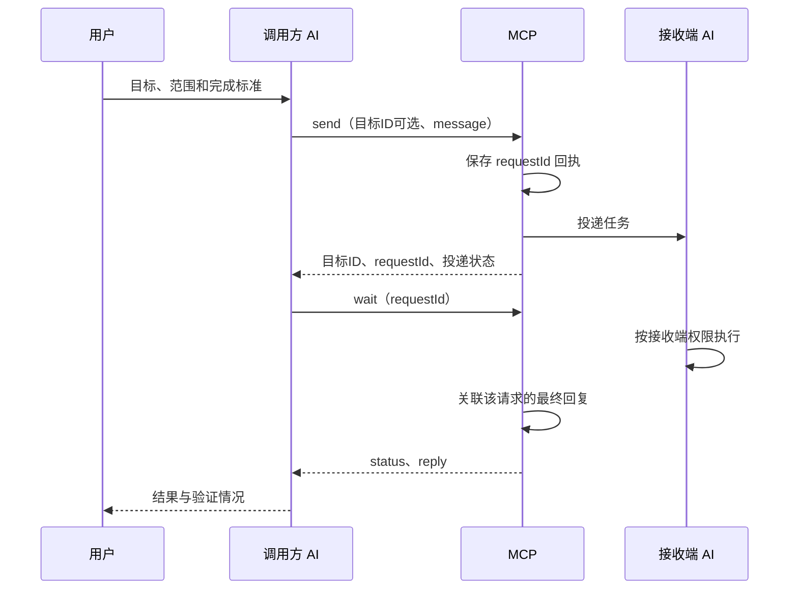

# 功能与原理讲解

本文解释这座桥能做什么，以及会话、任务和回复之间的关系。安装步骤见 [README](../README.md)，参数见 [工具参考](reference.md)。

## 快捷 Skill 与 MCP 的关系

1.1.0 起安装脚本会同时安装三个快捷 Skill。MCP 提供发送/读取的工具接口，Skill 将“选目标、发送一次、保留 requestId、等待并汇报”的步骤写成可重复调用的入口。

Claude 中使用 `/to-codex 任务内容` 或 `/to-codex --thread UUID 任务内容`。Codex 中使用 `$to-claude 任务内容`、`$to-claude --session UUID 任务内容`，或者 `$claude-sessions` 查询在线 ID。Codex 桌面可在技能选择器中按名称搜索。

这些 Skill 不启动其他委托包装器，也不替换目标会话的权限。省略目标 ID 仍表示新建，指定 ID 才续接。旧版用户运行 configure.cmd 后重启宿主即可获得入口。

## 1. 它连接的是正在使用的 AI 会话

你在 Claude Code 中提出任务，Claude 可以通过 MCP 把任务交给 Codex 桌面聊天；你在 Codex 中提出任务，也可以交给终端 Claude Code。接收端执行任务，调用方再读取结果。

MCP 在这里提供的是发送、等待、读取和查询接口。代码分析、文件修改、测试等工作由接收端 AI 按它自己的模型和权限执行。MCP 不承担模型推理，也不把一个账号的模型额度转给另一个账号。

### Claude → Codex 桌面

适合让某个 Codex 聊天继续处理它已了解的项目、审查方案或完成实现。传入精确的 `threadId` 就继续那个聊天；省略 ID 则创建新聊天，并通过 `codex://threads/<ID>` 请求桌面端打开它。

### Codex → Claude 终端

适合把任务交给在线 Claude 会话，或打开一个可见 Claude 终端处理新任务。传入精确的 `sessionId` 就继续对应的在线终端；省略 ID 则打开新终端，即使已有其他终端在线也不会自动复用。

终端版 Claude Code 即可使用，不需要 Claude 桌面版。该路由当前只列出、投递到原生终端 CLI 会话。

## 2. 会话 ID 和 requestId 不是同一回事

| 标识 | 指向什么 | 用途 |
| --- | --- | --- |
| Codex threadId | 一个 Codex 聊天 | 决定任务发给哪个聊天 |
| Claude sessionId | 一个 Claude 会话 | 决定任务发给哪个在线终端 |
| requestId | 一次任务投递 | 等待、查询和避免重复发送 |

一个会话可以依次接收很多任务，每次任务使用不同 requestId。发送后保留返回的 requestId，等待超时仍查询它，不能为了重试换一个 requestId 再发送相同任务。

### 获取 Claude 会话 ID

对 Codex 说：

> 用 claude-terminal 列出在线 Claude 会话，显示 ID、名称、项目目录和 PID。

返回的 `sessionId` 可以直接用于后续发送。手动恢复历史会话可以运行 `claude --resume <UUID>`，打开后再从在线列表确认。一个历史 UUID 存在，不代表它当前有可接收消息的终端进程。

### 获取 Codex 聊天 ID

由本桥新建聊天时，send 的返回值包含 `threadId` 和 `desktopLink`。已有聊天可通过宿主提供的聊天查看/管理工具获取精确 ID，或从已知的 `codex://threads/<UUID>` 链接读取。不要把聊天标题或 requestId 当成 threadId；本桥当前没有枚举全部 Codex 聊天的工具。

## 3. 如何决定项目目录

指定已有 ID 时，项目由目标会话决定，不能通过额外传 cwd 把会话搬到其他项目。

新建时应显式传入调用方当前项目的绝对 `cwd`。不传则继承 MCP 进程启动目录；如果你在会话中已经切换项目，这个启动目录可能不是现在的项目，因此应让 AI 根据当前上下文传 cwd。

支持同一本地用户下不同项目的会话，不需要修改会话白名单。跨项目投递仍应确认目标 ID 和工作范围，尤其是会修改文件的任务。

## 4. 一次任务的完整流程

send 返回只表明任务进入了某个投递阶段，不代表接收端已完成。单次 wait 最长 45 秒，默认 35 秒；任务更长时可以重复 wait。read 立即查询当前观察结果。

同一个 requestId 和相同任务内容重复调用不会再次发送或创建窗口。改变目标或任务内容后，不能继续使用旧 requestId。投递不确定时先观察原请求，不会自动盲目重发。

## 5. 两个方向如何实现

### Codex：queue 投递、桌面聊天执行

已有聊天使用原生 `codex queue --thread ... --message ...` 投递，避免用 `codex exec resume` 给同一个桌面聊天附加第二个 writer。

新聊天先由短生命周期 app-server 创建并持久化。创建进程退出、释放 writer 后，再请求桌面端打开聊天并投递任务。回复从本地 session JSONL 中按请求标记与 turn 读取，只返回最终文本，不返回思考过程或工具日志。

Codex 一个 turn 可能包含多个输入，因此返回的关联是“同一 turn”，不承诺每条输入都独占一个回复。已有其他输入的繁忙聊天，使用时应注意这个边界。

### Claude：原生 peer 通信、终端会话执行

使用随包保留许可证的上游 peer adapter，发现同一用户的在线终端，通过原生消息通道投递，再按消息 UUID 和 transcript ancestry 关联最终回复。

新窗口由 Python 用 Windows 的 CREATE_NEW_CONSOLE 启动原生 Claude exe，带预选 sessionId。只有新终端注册了匹配的会话 ID 和目录后才投递。遇到登录、信任提示或启动慢，返回 startup_pending，不能误投给其他旧终端。

这部分依赖 Claude 的内部协议和本地记录格式，CLI 更新后可能需要适配；不是官方稳定的通用聊天 API。

## 6. 如何写一个适合委托的任务

任务应包含目标、项目/文件线索、边界、完成标准和期望验证。例如：

> 把这个任务交给指定 Codex 聊天：检查当前项目的登录错误处理。只分析，不改文件。重点看 src/auth。指出可复现的问题、文件位置和建议验证步骤，最后给出简短结论。

允许修改时，应说明允许变更的范围以及测试要求。调用方收到“完成”后仍应按任务性质检查文件和测试证据，不能只凭对方自报判断验收通过。

## 7. 长消息与 token

发送限制是 **16,000 UTF-8 字节**，不是 16,000 个汉字。长代码或说明可以放在接收端能够访问的文件中，消息中给路径和必要目标。本项目不会自动传输文件、图片或附件。

Codex 回复默认完整返回，可用 `maxReplyChars` 限制本次读取的 Unicode 字符数；不设置就没有默认的 24,000 字符截断。Claude 路由没有相同的限长参数，需要控制返回量时可在任务中要求简洁输出。

调用方承担组织任务、工具调用和读取结果的 token，接收端承担实际分析/执行的 token。是否更省取决于传递内容、上下文大小与往返次数，不能仅凭 MCP 或 CLI 两个名字判断。

## 8. 权限、数据与当前范围

- 目标会话保留自己的模型、历史和权限；桥接不会代替用户批准接收端权限提示。
- 新 Codex 聊天创建时使用 on-request / workspace-write 配置；具体执行仍受宿主支持和权限规则约束。
- 登录信息沿用各自客户端；发行包不包含账号、密钥、会话历史或本地回执。
- 本地回执、配置备份与事务日志留在用户状态目录。它们可能含任务正文或原配置敏感信息，不要公开上传。
- 不会自动终止用户已有 Claude 窗口，不会自动循环让两个 AI 互相回复。
- 当前不支持远程机器、多用户通信、后台 Worker 调度、其他 AI CLI 执行器，或把文件作为附件跨机器传送。

## 9. 与参考项目的区别

| 项目 | 主要定位 | 与本项目的关系 |
| --- | --- | --- |
| oil-delegate | 用统一的 Skill/包装脚本委托多个外部 AI CLI，可续接 CLI session | 使用思路参考，本项目运行时不依赖它 |
| codex-mcp-bridge | 更广泛的桌面桥接、Worker 等通信能力 | 本项目只内置参考版本 2.4.0 的最小 Claude peer adapter，保留 MIT 许可 |
| 本项目 | Windows 本机 Codex 桌面与 Claude 终端的指定会话投递、回复读取和独立安装 | 聚焦这两个方向，提供可分享的源码和安装入口 |

这里描述的是本项目和参考版本，不代表上游项目的最新功能列表。上游来源及改动见 [第三方说明](../THIRD_PARTY_NOTICES.md)。
